<p align="center">
  
</p>

# Simulador de colas · Gran Colombia Car Wash Express

Aplicación web que simula, en 3D y con métricas en vivo, el sistema de colas de un lavadero de motos de Cúcuta: dos etapas en serie, lavado (M/M/6) y acabado (M/M/3). Es el software del proyecto final de Modelos Matemáticos (UDES).

**Aplicación publicada:** <https://keiverj.github.io/gran-colombia-carwash-simulador/>

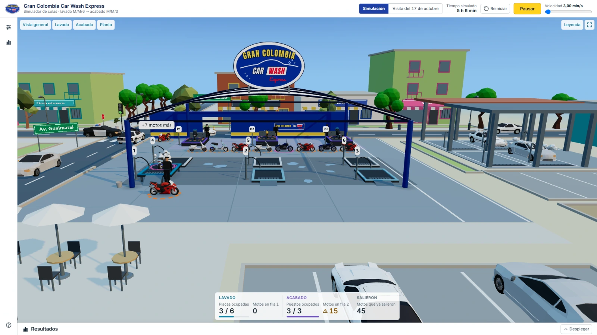

## Contenido

- [Contexto](#contexto)
- [El sistema real](#el-sistema-real)
- [El modelo](#el-modelo)
- [La visita del 17 de octubre](#la-visita-del-17-de-octubre)
- [Qué hace la aplicación](#qué-hace-la-aplicación)
- [Experimentos (simulación por lotes)](#experimentos-simulación-por-lotes)
- [Cómo usarla paso a paso](#cómo-usarla-paso-a-paso)
- [Supuestos y limitaciones](#supuestos-y-limitaciones)
- [Arquitectura](#arquitectura)
- [Cómo correrla localmente](#cómo-correrla-localmente)
- [Pruebas](#pruebas)
- [Tecnologías](#tecnologías)
- [Créditos](#créditos)
- [Licencia](#licencia)

## Contexto

Gran Colombia Car Wash Express es un lavadero de motos de Cúcuta, en la esquina de la Av. Gran Colombia con la Av. Guaimaral. Este proyecto lo estudia como un sistema de colas para la asignatura Modelos Matemáticos de la UDES.

- **Autor:** Keiver Esneid Castellanos Julio.
- **Docente:** Lorencita Rodríguez Galezo.
- **Datos:** salen de la observación del 17 de octubre de 2026 y de lo que dijo el personal del lavadero. La aplicación no inventa ninguno: cada parámetro está tomado de esa observación.

## El sistema real

- Las motos **entran por las dos avenidas** (Gran Colombia y Guaimaral) y se unen en **una sola fila**: la tasa de llegadas λ reúne las de ambas entradas.
- Hay tres planes: (1) lavado y encerado; (2) lavado, encerado y recuperación de partes negras; (3) lavado, encerado, partes negras y pulido de faros.
- **Etapa 1, lavado:** 6 placas de lavado (los servidores) con una fila de espera y disciplina FIFO.
- **Etapa 2, acabado:** 3 puestos en la parte de atrás del mismo local (los servidores) con su propia fila FIFO. Todas las motos pasan por aquí: el encerado siempre, las partes negras en los planes 2 y 3 y los faros en el plan 3.
- **Regla de asignación:** la moto revisa la placa 1; si está ocupada, la 2, y así hasta la 6. Si todas están ocupadas, espera en la fila 1, y cuando se libera una placa la primera de la fila revisa desde la placa 1. En el acabado es igual con los puestos 1, 2 y 3.
- **Sin bloqueo entre etapas:** al terminar el lavado la placa se libera de inmediato y la moto pasa a la fila del acabado. Nadie abandona la fila.
- **Personal:** 5 trabajadores sin tarea fija; 3 casi siempre en el acabado y los otros 2 sobre todo en el lavado. El modelo **no** los toma como servidores: los servidores son las placas y los puestos.
- **La observación del 17 de octubre de 2026,** por la tarde: se anotaron las horas de 23 motos y se hicieron 15 conteos de cuántas placas, puestos y motos en fila había. Ver [La visita del 17 de octubre](#la-visita-del-17-de-octubre).

## El modelo

Dos colas en serie. A la primera llegan las motos como un proceso de Poisson con tasa λ; se atienden en s₁ = 6 placas con tiempos exponenciales (M/M/6). Al salir pasan a la segunda, con s₂ = 3 puestos y tiempos exponenciales (M/M/3).

### Parámetros

| Parámetro | Valor | Origen |
|---|---|---|
| λ (llegadas, ambas entradas) | 14,1935 motos/h (una cada 4,2273 min) | 93 min entre 22 intervalos |
| μ₁ (lavado, por placa) | 5,5871 motos/h (media de 10,7391 min) | 247 min entre 23 motos |
| Acabado del plan 1 | 10 min | dicho por el personal, no medido |
| Acabado del plan 2 | 15,3158 min | 291 min entre 19 motos |
| Acabado del plan 3 | 18,5 min | 74 min entre 4 motos |
| Proporción de planes | q₁ = 0; q₂ = 0,8261; q₃ = 0,1739 | 0/23, 19/23 y 4/23 |
| E[S₂], acabado promedio | 15,8696 min | 0,8261 · 15,3158 + 0,1739 · 18,5 (= 365/23) |
| μ₂ (acabado, por puesto) | 3,7808 motos/h | 60 / 15,8696 |
| Placas y puestos | 6 y 3 | conteo en el lavadero |

El plan 1 no se vio en la visita (q₁ = 0), así que su tiempo de 10 min es lo que dijo el personal y no una medida.

### Fórmulas M/M/s

Con a = λ/μ y ρ = λ/(μ·s), válidas solo si ρ < 1:

- P₀ = 1 / [ Σₙ₌₀^(s−1) aⁿ/n! + (aˢ/s!) · (s/(s − a)) ]
- Lq = a^(s+1)/(s − 1)! · 1/(s − a)² · P₀
- Wq = Lq/λ
- W = Wq + 1/μ
- L = λ·W

Si ρ ≥ 1 la aplicación no calcula P₀, Lq ni Wq: muestra «inestable».

### Resultados esperados

| Escenario | ρ | P₀ | Lq | Wq (min) | W (min) | L |
|---|---|---|---|---|---|---|
| Etapa 1, 5 placas | 0,508 | 0,077 | 0,14 | 0,60 | 11,34 | — |
| Etapa 1, 6 placas (actual) | 0,4234 | 0,07834 | 0,0372 | 0,16 | 10,90 | 2,58 |
| Etapa 1, 7 placas | 0,363 | 0,079 | 0,01 | 0,04 | 10,78 | — |
| Etapa 2, 3 puestos (actual) | 1,2514 | inestable | — | — | — | — |
| Etapa 2, 4 puestos | 0,9385 | 0,00644 | 13,24 | 56,0 | 71,8 | 16,99 |
| Etapa 2, 5 puestos | 0,7508 | 0,01858 | 1,40 | 5,9 | 21,8 | 5,15 |

### El hallazgo principal: el acabado se satura

Con los 3 puestos que hay hoy, **ρ₂ = 1,2514**. Como es mayor que 1, la fila del acabado no se estabiliza: crece sin límite mientras el local esté abierto. Los 3 puestos solo dan abasto hasta λ = 11,34 motos/h (3 · μ₂) y están llegando 14,19. Para que 3 puestos fueran estables, el acabado tendría que durar menos de 12,7 min.

El lavado, en cambio, trabaja con holgura (ρ₁ = 0,4234).

- Con **4 puestos** el sistema sería estable, pero justo (ρ = 0,9385): una moto esperaría 56 min en la fila del acabado y estaría 71,8 min en el lavadero.
- Con **5 puestos** (ρ = 0,7508) la espera baja a 5,9 min y el tiempo total a 21,8 min.

La aplicación muestra esto mismo con la simulación: ver las gráficas de saturación en [Gráficas](#gráficas).

## La visita del 17 de octubre

El modo «Visita del 17 de octubre» reproduce **las 23 motos** de esa tarde con sus horas reales de llegada, entrada y salida de la placa, plan, y inicio y fin del acabado, de las 3:10 a las 5:30 p. m. En este modo los tiempos no son aleatorios. Parte de todo vacío, aunque a las 3:10 había 2 motos en la fila del lavado y 1 puesto ocupado.

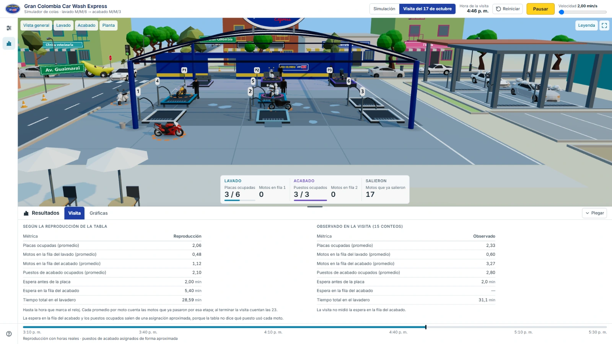

Resultados de reproducir la tabla de horas, frente a lo observado en 15 conteos hechos aparte:

| Métrica | Reproducción de la tabla | Observado (15 conteos) |
|---|---|---|
| Placas ocupadas (promedio) | 1,76 | 2,33 |
| Motos en la fila del lavado (promedio) | 0,33 | 0,60 |
| Motos en la fila del acabado (promedio) | 0,82 | 3,27 |
| Puestos de acabado ocupados (promedio) | 2,20 | 2,80 |
| Espera antes de la placa | 2,00 min | 2,0 min |
| Tiempo total en el lavadero | 31,13 min | 31,1 min |

La espera antes de la placa y el tiempo total **coinciden**. Las ocupaciones **difieren** por cuatro razones, que la propia aplicación explica debajo de la tabla:

1. Esos valores vienen de 15 conteos hechos aparte, no de la tabla de horas.
2. El lavadero real no asigna por «primer libre».
3. Al llegar había motos en fila con placas libres (se tomó la hora anotada como llegada).
4. A las 3:10 había una moto en el acabado que no se reproduce.

La visita no midió la espera en la fila del acabado; la reproducción la estima en 5,00 min con una asignación aproximada de puestos, porque la tabla no dice qué puesto usó cada moto.

## Qué hace la aplicación

### La escena 3D y las vistas de cámara

La escena es el centro de la pantalla: el local con techo de lona sobre arcos, las dos avenidas, las 6 placas de lavado con su número, la fila de espera, los puestos de acabado (P1, P2 y P3) atrás, la cafetería y los edificios de la esquina. Las motos se mueven de la entrada a la fila, a la placa, a la fila del acabado, al puesto y a la salida.

- **Aro del plan:** cada moto lleva en el piso un aro con el color y el trazo de su plan (plan 1 sólido, plan 2 en segmentos y plan 3 doble).
- **Placas y puestos:** una losa plana y gris está libre; una elevada, con la moto encima, está ocupada.
- **Cuatro vistas:** «Vista general», «Lavado», «Acabado» y «Planta». El botón «Leyenda» explica los aros y las losas.

| Lavado | Acabado |
|---|---|
| 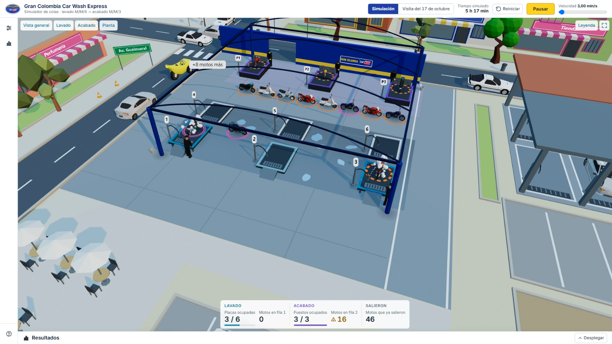 | 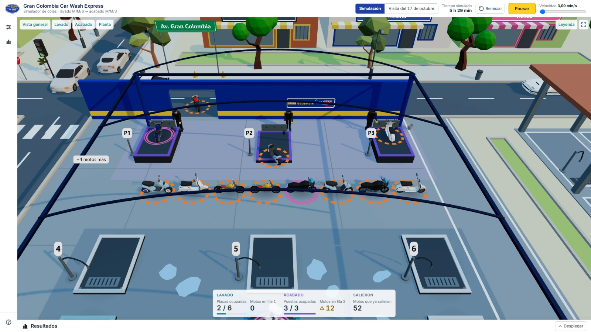 |

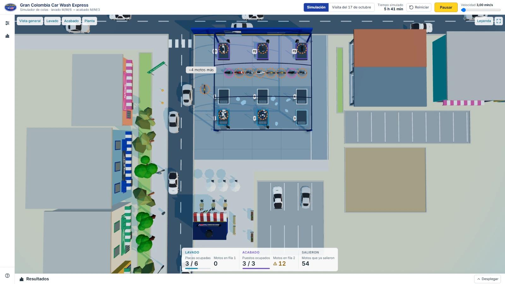

**Cómo mover la cámara:** con el clic izquierdo sostenido la vista gira; con el clic derecho sostenido se desplaza (arriba y abajo cambia la altura y a los lados recorre la escena); la rueda acerca. En el celular, un dedo gira y dos dedos desplazan y acercan. La cámara no baja del piso ni se aleja más que la vista «Planta». Los botones de vista devuelven la cámara a su sitio con una transición suave que no pausa ni reinicia nada.

### Ajustes y rangos

El panel **Ajustes** (el primer ícono de la barra lateral) se abre sobre la escena sin achicarla. Todo cambia sin recargar la página.

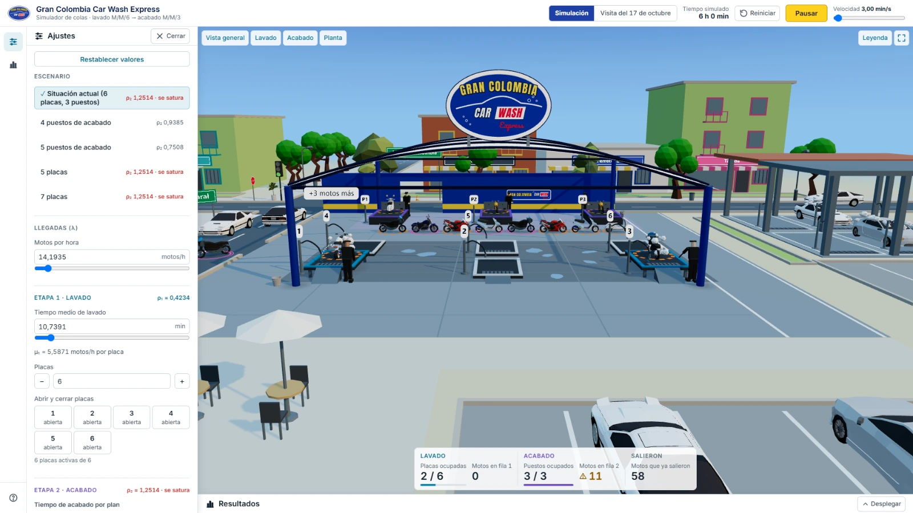

| Ajuste | Rango |
|---|---|
| Llegadas λ | de 1 a 200 motos/h |
| Tiempo medio de lavado | de 0,5 a 120 min |
| Tiempo de acabado de cada plan | de 0,5 a 120 min |
| Proporción de cada plan | de 0 a 100 % (suman 100 %) |
| Placas | de 1 a 14 |
| Puestos | de 1 a 7 |
| Semilla | de 0 a 4 294 967 295 |
| Velocidad de la simulación | de 0,25 a 120 min simulados por segundo |
| Corrida larga | 100, 1000 o 5000 horas |

Los campos numéricos aceptan coma o punto, y si un valor no se puede aplicar lo dicen con un mensaje. Hay dos modos de acabado: «Según su plan» (cada moto usa la media de su plan) y «Un solo promedio (M/M/s)» (una sola exponencial con la media E[S₂], para comparar con las fórmulas). Con la misma semilla y los mismos parámetros la simulación da siempre los mismos resultados.

### Escenarios

Cinco escenarios predefinidos, más la visita:

- Situación actual (6 placas, 3 puestos).
- 4 puestos de acabado.
- 5 puestos de acabado.
- 5 placas.
- 7 placas.
- Visita del 17 de octubre (con el selector «Simulación» / «Visita del 17 de octubre» de la barra superior).

Cada escenario muestra su ρ₂ y avisa si «se satura».

### Abrir y cerrar placas y puestos

Sirve para ver qué pasa si, por ejemplo, una placa se daña o un puesto se queda sin personal. Se hace con los botones de «Abrir y cerrar placas» (o puestos) en Ajustes, o tocando una placa o un puesto en la escena.

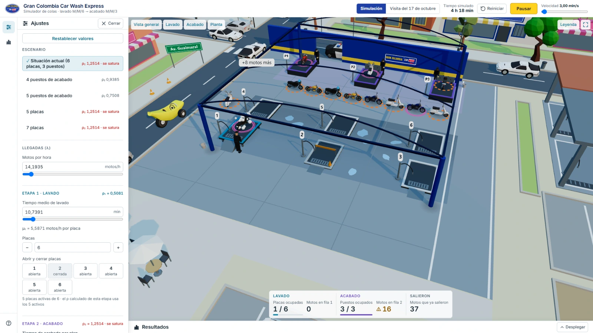

- Un servidor cerrado no recibe motos nuevas; se ve más bajo y gris, con una barrera y un cono.
- Si tenía una moto, la termina de atender y luego se cierra («cerrándose»).
- En cada etapa tiene que quedar al menos un servidor abierto.
- La simulación no se reinicia. Las fórmulas usan los servidores que están abiertos en ese momento, y una nota avisa de que lo simulado incluye periodos con otro número de servidores.
- En la visita y durante la corrida larga no se puede abrir ni cerrar nada.

### Corrida larga

El botón «Corrida larga (estado estable)» simula **100, 1000 o 5000 horas** seguidas, desde cero, para que los valores simulados se acerquen a los calculados. Muestra el progreso, se puede cancelar y la escena la enseña en cámara rápida durante unos segundos. Si hay una simulación en curso, pide confirmar porque la descarta.

### Métricas: simulado frente a calculado

La pestaña **Métricas** del panel Resultados compara, para cada etapa, ρ, Lq, Wq, W y L entre lo **simulado** (promedios en el tiempo para ρ, L y Lq; promedios por moto para W y Wq) y lo **calculado con las fórmulas**, y da el tiempo total en el lavadero. Si una etapa tiene ρ ≥ 1 muestra un aviso de saturación y «inestable» en lugar de las fórmulas.

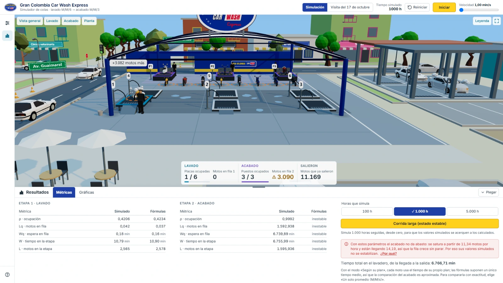

Ejemplo real de esa captura (corrida larga de 1000 h, semilla 1, 6 placas y 3 puestos):

| Etapa 1 · Lavado | Simulado | Fórmulas |
|---|---|---|
| ρ | 0,4206 | 0,4234 |
| Lq | 0,042 | 0,037 |
| Wq | 0,18 min | 0,16 min |
| W | 10,79 min | 10,90 min |
| L | 2,565 | 2,578 |

En la etapa 2 las fórmulas dicen «inestable»: el ρ simulado es 0,9992 (los puestos casi nunca descansan) y la fila 2 llegó a 3.090 motos al final de las 1000 horas.

### Gráficas

La pestaña **Gráficas** tiene cuatro gráficas; la última solo aparece en la visita. Cada una se puede ver también como tabla.

1. **Las dos filas en el tiempo,** en tiempo real mientras corre la simulación.
2. **Ocupación de cada servidor,** en % del tiempo, para cada placa y cada puesto.
3. **En qué se va el tiempo promedio** de una moto: espera en la fila 1, lavado, espera en la fila 2 y acabado.
4. **El tiempo de cada moto en el lavadero** (solo en la visita).

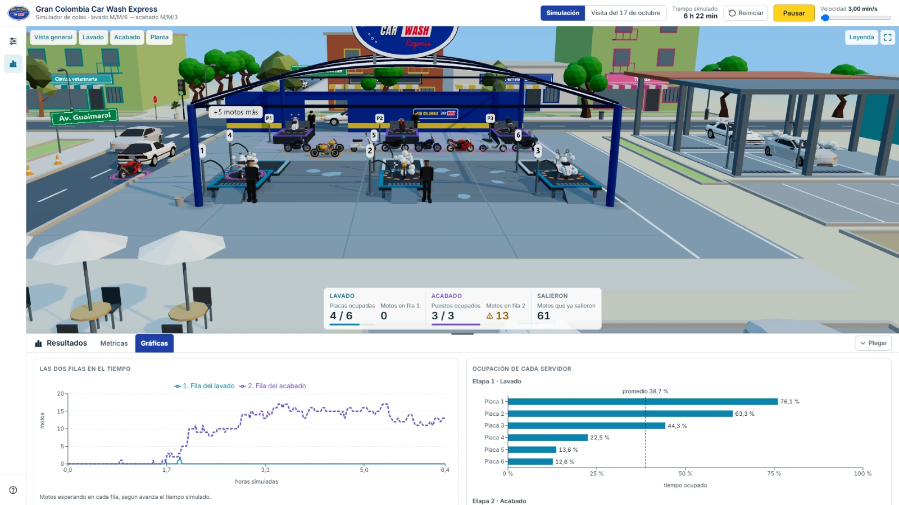

**La saturación se ve.** Misma corrida larga de 1000 horas, con 3 y con 5 puestos:

| 3 puestos: la fila 2 crece sin parar | 5 puestos: la fila 2 se mantiene baja |
|---|---|
|  |  |

Con 3 puestos la fila 2 sube hasta 3.090 motos y los tres puestos pasan ocupados el 99,9 % del tiempo. Con 5 puestos la fila oscila entre 0 y unas 15 motos.

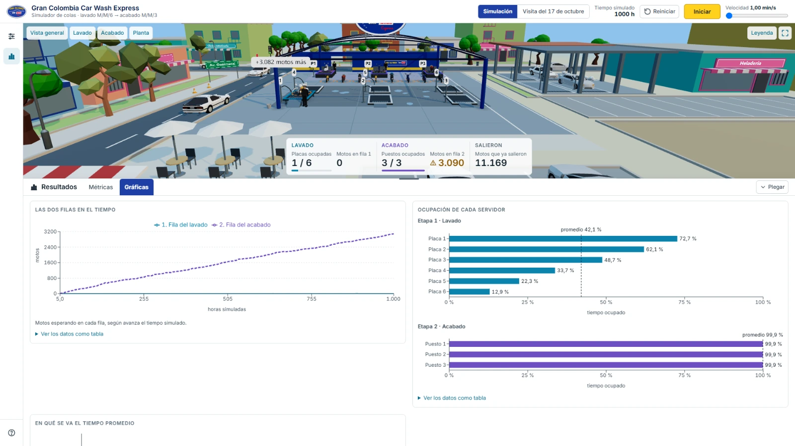

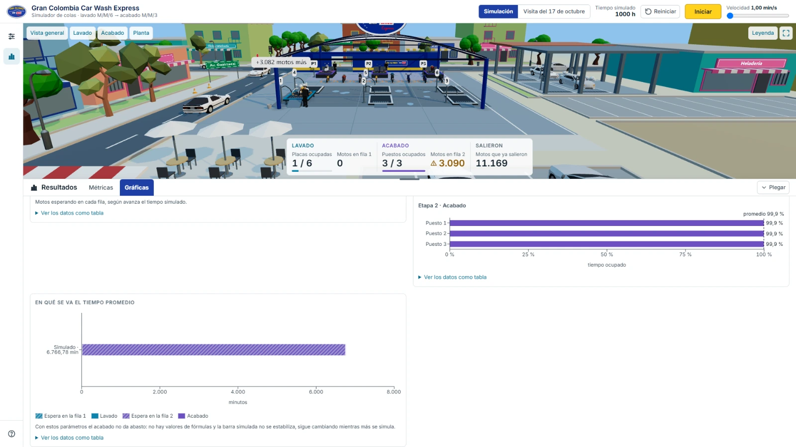

### Modo visita

Ya descrito [arriba](#la-visita-del-17-de-octubre): reloj de la tarde, una línea de tiempo que marca la hora que se reproduce y, en Resultados, la pestaña **Visita** con la reproducción frente a lo observado.

### Ayuda

El ícono de interrogación al pie de la barra lateral abre una ayuda con los pasos de uso, una explicación de los experimentos y del intervalo de confianza, el significado de los tres planes, cómo cerrar y abrir servidores, qué significa cada vista y los créditos.

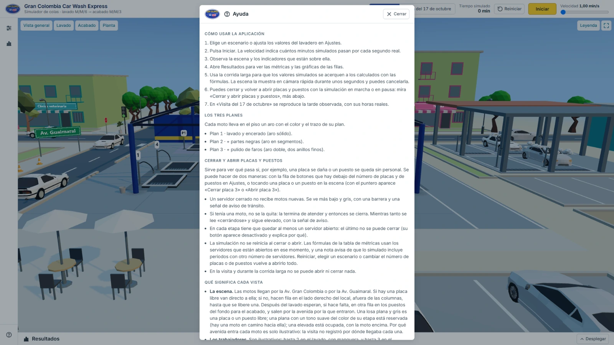

### En el celular

En pantallas angostas la barra superior se compacta, la escena queda arriba y los paneles pasan a una hoja inferior deslizable con las pestañas Ajustes, Gráficas y Métricas, y un botón «Experimentos» en la barra de arriba que abre la vista a pantalla completa. Los botones miden al menos 44 px.

<p align="center">
  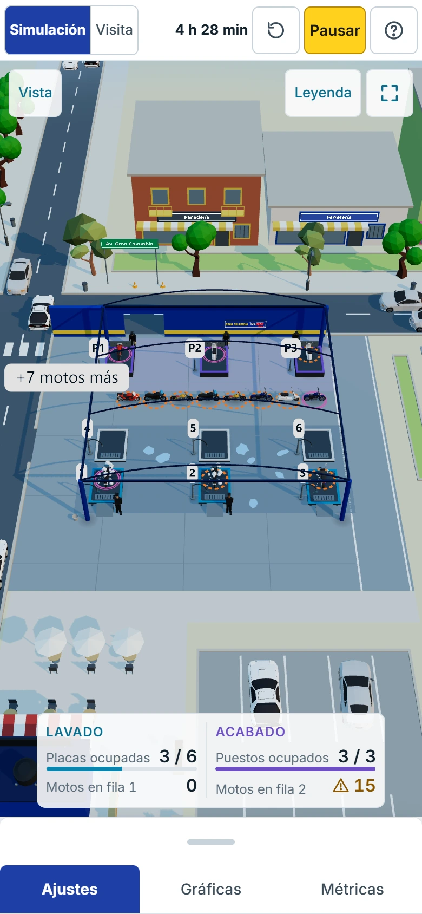
</p>

### Calidad adaptable

Si los cuadros por segundo bajan (un equipo sin tarjeta gráfica, un celular modesto), la escena apaga por pasos lo que menos se echa de menos y al final baja la resolución; si el rendimiento mejora, lo devuelve en el orden contrario. El orden es: tráfico de ambiente, edificios de la esquina, gotas y espuma, charcos, personas, sombras y reflejos del entorno, y por último la resolución (a tres cuartos y a la mitad). No toca la simulación: solo cómo se dibuja.

### Accesibilidad

- Un enlace «Saltar al contenido» al principio de la página.
- Las pestañas y los grupos de opciones se recorren con las flechas del teclado.
- Los avisos se anuncian a las ayudas técnicas.
- Nada se identifica solo por el color: lo elegido lleva una marca y los planes se distinguen por el trazo del aro.
- La letra es Inter, con números de ancho fijo para que las cifras no bailen, y los colores de texto se comprobaron para que alcancen el contraste.
- Si el sistema pide «reducir movimiento», las transiciones se apagan.

## Experimentos (simulación por lotes)

Una simulación sola da un número que depende del azar de su semilla. **Experimentos** es una vista propia: el ícono del matraz de la barra lateral, debajo de Resultados (en el celular, el de la barra de arriba), abre una vista completa sobre la escena, con la configuración a la izquierda y los resultados en grande a la derecha. Se cierra con «Cerrar», con Escape o con el mismo ícono, y la escena vuelve como estaba, sin reiniciar la simulación; mientras la vista está abierta la escena deja de dibujarse para no gastar recursos. No está disponible en el modo visita (el ícono se ve apagado y dice por qué). Corre muchas simulaciones **sin animación y en segundo plano** —en un Web Worker, así que la escena y los controles siguen respondiendo— y las resume con el promedio, la desviación estándar y un **intervalo de confianza del 95 %** (con la distribución t de Student), junto al valor de las fórmulas. Parte de los valores de Ajustes y no toca la simulación en vivo; si se cierra la vista con un experimento corriendo, sigue en segundo plano y el tooltip del ícono dice cuánto lleva. Usa el motor y las fórmulas tal cual están: no cambia ninguna cifra de lo demás.

**Qué es un intervalo de confianza.** Es un rango alrededor del promedio simulado. Si el experimento se repitiera muchas veces con otras semillas, en 95 de cada 100 el rango incluiría el valor verdadero del sistema. Un rango angosto quiere decir que el resultado es firme; uno ancho, que faltan réplicas. Si el valor de las fórmulas cae «dentro» del rango, la simulación y las fórmulas concuerdan. «Fuera» no siempre es un error: con un 95 %, en promedio 1 de cada 20 queda fuera por puro azar. Se comprobó con 40 semillas base distintas (30 réplicas de 1000 h cada una, situación actual): las fórmulas cayeron dentro del intervalo en 192 de 200 casos (96 %).

**Cómo usarlo.** Abre la vista, elige un modo, revisa los valores (la semilla base, las horas de cada corrida y el calentamiento) y pulsa «Iniciar experimento». Aparecen una barra de avance con el tiempo que falta y el botón «Cancelar», que muestra lo que alcanzó a terminar. Mientras no se pida más de **200 000 horas simuladas en total** (si se pide más, no arranca y dice qué bajar) tarda unos segundos: 150 000 h simuladas tardaron unos 5 s. Cada corrida usa una semilla distinta (la semilla base, base + 1, …), así que con la misma configuración sale exactamente lo mismo. El **calentamiento** son las horas iniciales que no cuentan para las métricas: 10 % por defecto y ajustable de 0 a 50 %. «Exportar a CSV» baja los resultados del modo con separador `;` y coma decimal (para Excel en español); la primera fila dice los parámetros, la semilla base, las horas, el calentamiento y las réplicas.

### Réplicas

Corre de 5 a 100 réplicas de 100, 1000 o 5000 horas. Por cada métrica de cada etapa y del tiempo total da el promedio, la desviación, el intervalo y el valor de las fórmulas, con «dentro» o «fuera» escrito. Una etapa inestable (ρ ≥ 1) no lleva intervalo ni fórmulas: la tabla dice cuántas motos esperaban en la fila a la mitad y al final de la corrida para que se vea que crece.

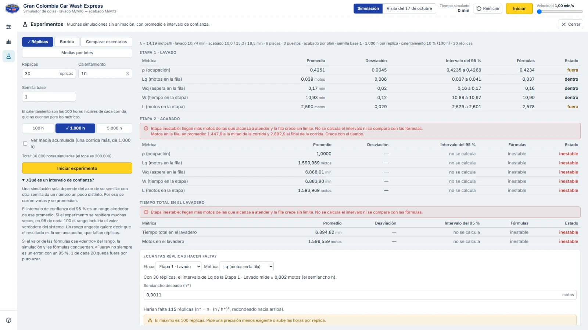

Ejemplo real de esa captura (30 réplicas de 1000 h, semilla base 1, 6 placas y 3 puestos), etapa de lavado:

| Métrica | Promedio | Intervalo del 95 % | Fórmulas |
|---|---|---|---|
| ρ | 0,4251 | 0,4235 a 0,4268 | 0,4234 (fuera, por poco) |
| Lq | 0,0392 | 0,0371 a 0,0414 | 0,0372 (dentro) |
| W | 10,9271 min | 10,8833 a 10,9708 | 10,8966 (dentro) |

En el acabado, con 3 puestos, las fórmulas dicen «inestable»: la fila 2 tenía en promedio 1.447,9 motos a mitad de la corrida y 2.892,9 al final.

**¿Cuántas réplicas hacen falta?** Con resultados a la vista se elige una métrica y el semiancho que se quiere (la mitad del ancho del intervalo, h\*), y la pantalla calcula n\* = n · (h / h\*)², redondeado hacia arriba, con un botón para correr esa cantidad (las primeras réplicas repiten las de antes). Por ejemplo, con las 30 réplicas el semiancho de Lq del lavado es 0,00215 motos; si se pide 0,0011 (más o menos la mitad, que es lo que propone la pantalla), harían falta 115 réplicas, más que el máximo de 100: el botón se desactiva y explica qué cambiar. Es una estimación: supone que la variación entre réplicas no cambia al correr más.

### Barrido

Mueve un parámetro (λ, placas, puestos, tiempo de lavado o tiempo de acabado) en un rango con un paso (hasta 30 valores) y corre las mismas réplicas, con las mismas semillas, para cada valor. Dibuja la métrica elegida con el promedio, una franja con su intervalo, la curva de las fórmulas y la marca de dónde la etapa se satura (ρ = 1), y trae la misma información en una tabla. El tiempo de acabado que se barre es el promedio de los tres planes.

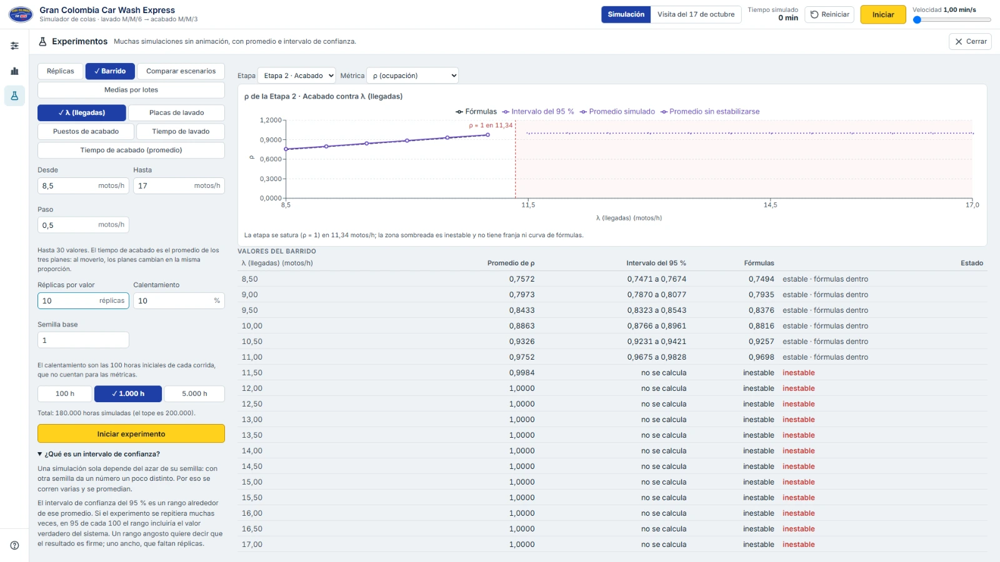

Ejemplo real (λ de 8,5 a 17 motos/h de 0,5 en 0,5, 10 réplicas de 1000 h, semilla base 1, 3 puestos): las fórmulas dan ρ₂ = 1 en λ = 11,34 motos/h (3 · μ₂ = 3 · 3,7808). Con λ = 11 el ρ₂ simulado es 0,9752 (0,9675 a 0,9828) y el de las fórmulas, 0,9698; con λ = 11,5 las fórmulas dicen «inestable» y el ρ₂ simulado es 0,9984.

### Comparar escenarios

Corre los cinco escenarios con las mismas semillas y los pone lado a lado: promedio e intervalo de cada métrica. Debajo calcula la **diferencia** de cada escenario contra uno de referencia (la situación actual por defecto; se puede elegir otro), réplica a réplica con la misma semilla, con su intervalo del 95 %, y dice si es **significativa** (el intervalo no contiene el cero). Si la etapa es inestable en el escenario o en la referencia, lo dice en lugar de calcular la diferencia.

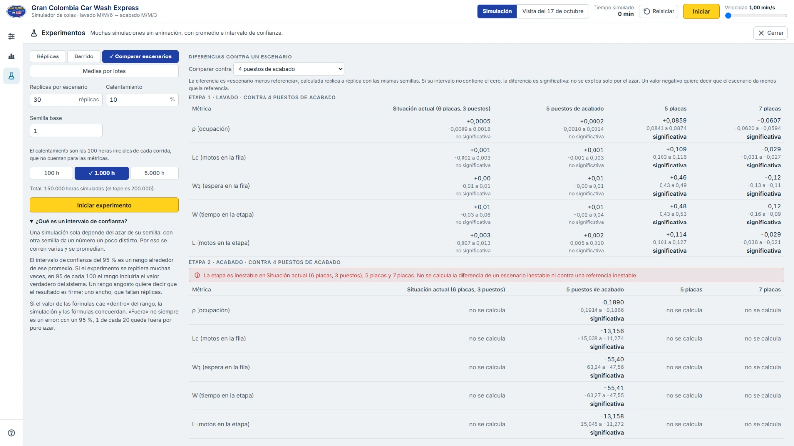

Ejemplo real (30 réplicas de 1000 h, semilla base 1): contra la situación actual (3 puestos, inestable en el acabado) las diferencias de 4 y de 5 puestos no se pueden calcular. Entre 4 y 5 puestos sí: con 5 puestos la espera en la fila del acabado (Wq₂) baja 55,40 min (intervalo de −63,24 a −47,56), y es significativa; ρ₂ baja 0,1890 (de −0,1914 a −0,1866).

### Medias por lotes

Una sola corrida larga, con su calentamiento, cortada en k lotes de igual duración (de 10 a 50); el intervalo del 95 % sale de las medias de los lotes. Réplicas corre varias simulaciones independientes; Medias por lotes corre una sola, más larga: cuesta menos, pero los lotes vecinos pueden parecerse entre sí.

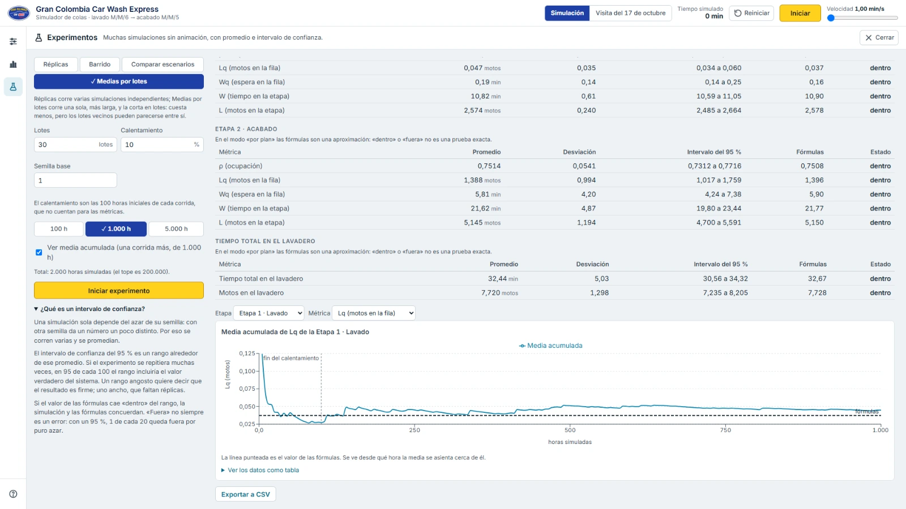

Ejemplo real (1000 h, 30 lotes, 10 % de calentamiento, semilla base 1, 5 puestos): en el lavado ρ = 0,4212 (0,4079 a 0,4346) frente a 0,4234 de las fórmulas, y las 12 métricas de las dos etapas y del total caen dentro del intervalo.

**Media acumulada.** En Réplicas y Medias por lotes, «Ver media acumulada» añade una corrida de observación (sin calentamiento, con la semilla base) y dibuja cómo se va asentando el promedio de la métrica que se elija, con una marca donde termina el calentamiento y la línea de las fórmulas. Se ve desde qué hora el promedio se estabiliza; con una etapa inestable no se estabiliza y no hay línea de fórmulas.

## Cómo usarla paso a paso

Una guía corta para probar la aplicación:

1. **Abre la aplicación.** Ya está en la «Situación actual (6 placas, 3 puestos)» con los datos medidos.
2. **Pulsa «Iniciar»** (arriba, en amarillo). Las motos llegan, se lavan y pasan al acabado. Los indicadores sobre la escena muestran las placas y puestos ocupados y las motos en cada fila.
3. **Cambia la velocidad** con el deslizador de arriba a la derecha: indica cuántos minutos simulados pasan por cada segundo real.
4. **Mira desde otro lugar** con los botones «Vista general», «Lavado», «Acabado» y «Planta».
5. **Elige otro escenario:** abre Ajustes (primer ícono de la barra lateral) y elige, por ejemplo, «5 puestos de acabado». Verás el ρ₂ de cada uno y si «se satura».
6. **Haz una corrida larga:** abre Resultados (segundo ícono), pestaña Métricas, elige las horas y pulsa «Corrida larga (estado estable)».
7. **Lee las métricas:** compara las columnas «Simulado» y «Fórmulas». En el acabado con 3 puestos las fórmulas dicen «inestable» y aparece el aviso de saturación.
8. **Mira las gráficas** en la pestaña Gráficas: con 3 puestos la fila 2 crece sin parar; con 5 se mantiene baja.
9. **Haz un experimento:** abre «Experimentos» (el matraz de la barra lateral), deja «Réplicas» y pulsa «Iniciar experimento». Verás el promedio y el intervalo del 95 % de cada métrica junto a las fórmulas; prueba «Barrido» para ver dónde el acabado se satura y «Comparar escenarios» para ver si 5 puestos mejora de verdad a 4.
10. **Mira la visita:** arriba, elige «Visita del 17 de octubre» y pulsa «Iniciar». En Resultados, la pestaña Visita compara la reproducción con lo observado.
11. **Vuelve a empezar** con «Reiniciar». Con la misma semilla y los mismos ajustes se repite exactamente lo mismo.

## Supuestos y limitaciones

- **Llegadas de Poisson y tiempos exponenciales.** Es lo que suponen las fórmulas M/M/s. Los tiempos reales pueden no ser exponenciales; con tan pocas observaciones no se puede comprobar.
- **Fila infinita, disciplina FIFO y nadie abandona la fila.** Ninguna moto se va por esperar mucho.
- **Los trabajadores no son servidores.** Los servidores son las placas y los puestos. Los trabajadores que se ven en la escena (hasta 2 en el lavado y hasta 3 en el acabado) son ilustrativos y no cambian ninguna cifra.
- **Asignación aproximada de puestos en la visita.** La tabla de la visita no dice qué puesto usó cada moto, así que la espera en la fila del acabado y los puestos ocupados salen de una asignación aproximada.
- **La avenida de entrada es ilustrativa.** La visita no registró por qué avenida llegó cada moto; en la escena se decide por el número de la moto, nunca con el generador aleatorio de la simulación. No afecta ninguna métrica porque λ reúne las dos entradas.
- **El lavado de carros y la cafetería son solo decorativos.** El lavado de carros del mismo local, la cafetería con su terraza, la caja de cobro, los clientes y los carros del parqueadero y de la calle no entran en la simulación.
- **El pago no es una etapa.** El modelo no incluye el cobro.
- **Con 3 puestos el acabado no tiene estado estable:** sus valores simulados siguen creciendo mientras más se simula.
- **En el modo «Según su plan»** cada moto usa el tiempo de su plan; las fórmulas suponen un único tiempo medio, así que la comparación del acabado es aproximada. Para compararla con exactitud se elige «Un solo promedio (M/M/s)».
- **Los experimentos son simulados, no mediciones.** Los intervalos dicen cuánto confiar en un promedio simulado, no en el lavadero real; dependen de los supuestos de arriba. El calentamiento (10 % por defecto) y el tope de 200 000 horas simuladas por experimento son decisiones del programa, no datos medidos. Los experimentos usan todas las placas y puestos de Ajustes: los servidores cerrados no cuentan.
- **El plan 1** (lavado y encerado) tiene un tiempo de acabado de 10 min dicho por el personal, no medido.

## Arquitectura

El motor de simulación es JavaScript puro, separado de la interfaz: no importa React ni Three.js ni toca el DOM, así que corre en las pruebas con Node.

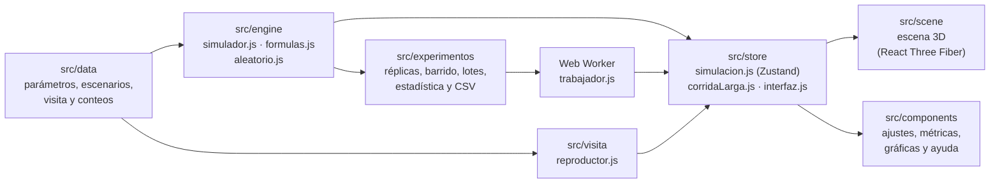

- **`src/engine/`** es el motor de eventos discretos. Tres eventos (llegada, fin de lavado y fin de acabado), generador aleatorio con semilla, colas FIFO, asignación al primer servidor libre en orden y servidores que se pueden cerrar y abrir. `formulas.js` trae las fórmulas M/M/s.
- **`src/visita/reproductor.js`** reproduce las 23 motos de la visita con sus horas reales y entrega una foto del estado con la misma forma que la del motor.
- **`src/experimentos/`** (JavaScript puro, como el motor) corre las réplicas, los barridos, la comparación de escenarios y las medias por lotes con el motor tal cual, calcula promedios, desviaciones, intervalos de confianza, diferencias entre escenarios y réplicas necesarias, y escribe el CSV. `trabajador.js` es la envoltura que corre un lote en un Web Worker; cancelar lo termina.
- **`src/store/`** guarda los parámetros, la instancia del motor, la velocidad y el estado en Zustand, y tiene el ciclo que avanza el motor con `requestAnimationFrame`. Toda entrada pasa por su validación de rangos. `experimentos.js` guarda lo elegido en la vista Experimentos, el lote en curso y sus resultados, aparte de la simulación en vivo.
- **`src/scene/`** es la escena 3D con React Three Fiber: lee la foto del estado y dibuja. No cambia la simulación.
- **`src/components/`** es la interfaz: barra superior, barra lateral, Ajustes, Resultados, gráficas con Recharts y Ayuda.

## Cómo correrla localmente

Requisitos: **Node 22.12 o más reciente** (Vite 8 pide 20.19 o 22.12 en adelante y Vitest 5 pide 22.12, 24 o 26 en adelante) y npm. El proyecto se desarrolló con Node 26.3.0.

```bash
npm install        # instala las dependencias
npm run dev        # servidor de desarrollo
npm test           # corre las pruebas (Vitest)
npm run build      # compila para producción en dist/
npm run preview    # sirve lo compilado para probarlo
npm run deploy     # publicación manual de dist/ en la rama gh-pages (alternativa)
```

**Publicación.** Cada vez que se sube algo a `main`, un flujo de GitHub Actions (`.github/workflows/pages.yml`) corre `npm ci`, `npm test` y `npm run build` y publica `dist/` en GitHub Pages; si una prueba falla, no publica. En Settings → Pages la fuente debe ser «GitHub Actions».

La aplicación se sirve bajo `/gran-colombia-carwash-simulador/` (la base de `vite.config.js`), así que en desarrollo y en `preview` se abre en `http://localhost:<puerto>/gran-colombia-carwash-simulador/`.

La página publicada no pide nada a internet: la fuente Inter, los modelos 3D, los logos y el ícono salen del propio sitio.

## Pruebas

`npm test` corre **2575 pruebas en 138 archivos** con Vitest, todas con Node y sin navegador. Cubren:

- **Fórmulas M/M/s** contra cada fila de la tabla de resultados esperados.
- **Motor de simulación:** misma semilla y mismos parámetros dan los mismos resultados; con muchas horas simuladas el lavado con 5, 6 y 7 placas y el acabado con 4 y 5 puestos se acercan a las fórmulas; con 3 puestos la fila 2 crece sin límite; servidores fuera de servicio; una fila que no se vuelve lenta al crecer.
- **Datos y visita:** parámetros, escenarios, la tabla de las 23 motos, los 15 conteos y el reproductor.
- **Store y corrida larga:** validación de rangos, progreso, cancelación y fallos.
- **Experimentos:** el cuantil t y los intervalos contra valores conocidos; que con la misma semilla base salga lo mismo; que las fórmulas caigan dentro del intervalo en la gran mayoría con 6 placas y 5 puestos; que el barrido marque la inestabilidad en λ = 11,34 con 3 puestos; que entre 4 y 5 puestos la diferencia de Wq₂ sea significativa y contra 3 puestos no se calcule; las réplicas necesarias hechas a mano; que cancelar deje todo coherente; que el CSV se lea de vuelta; y que un lote no toque la simulación en vivo.
- **Escena:** recorridos de las motos, cámara y sus límites, colocación de placas y puestos, carga de modelos y de logos, y calidad adaptable.
- **Interfaz:** campos numéricos, navegación con el teclado, métricas, gráficas, ayuda y accesibilidad.
- **Estilos:** colores y medidas que salen del tema, contraste, y que no haya franjas ni degradados en la interfaz.
- **Publicación:** que la página no pida nada a internet, que los créditos y el README estén completos y que ninguna prueba dependa de archivos que no están en el repositorio, para que `npm test` pase también en un clon limpio.

## Tecnologías

| Para qué | Qué |
|---|---|
| Interfaz | [React](https://react.dev) 19 |
| Compilación y servidor | [Vite](https://vite.dev) 8 con `@vitejs/plugin-react` |
| Escena 3D | [three](https://threejs.org), [React Three Fiber](https://r3f.docs.pmnd.rs) y [Drei](https://drei.docs.pmnd.rs) |
| Estado | [Zustand](https://zustand.docs.pmnd.rs) 5 |
| Gráficas | [Recharts](https://recharts.org) 3 |
| Experimentos en segundo plano | Web Workers del navegador (Vite los empaqueta) |
| Pruebas | [Vitest](https://vitest.dev) 5 |
| Revisión de código | [oxlint](https://oxc.rs) (`npm run lint`) |
| Publicación | [gh-pages](https://github.com/tschaub/gh-pages) y GitHub Pages |

JavaScript, no TypeScript. Las versiones exactas están en `package.json`.

## Créditos

**Fuentes.** La interfaz usa [Inter](https://rsms.me/inter/) de The Inter Project Authors, con licencia [SIL Open Font License 1.1](https://openfontlicense.org). La aplicación la sirve desde su propio sitio, junto con el texto de la licencia.

**Logo.** El logo del local es una recreación en vectores. Su texto se dibujó con dos fuentes de Google Fonts y ya viene convertido en trazos dentro del archivo, así que la aplicación no carga ninguna de las dos:

- [Anton](https://fonts.google.com/specimen/Anton), de The Anton Project Authors.
- [Pacifico](https://fonts.google.com/specimen/Pacifico), de The Pacifico Project Authors.

Las dos tienen la licencia [SIL Open Font License 1.1](https://openfontlicense.org).

**Modelos 3D.** Todos son de [Poly Pizza](https://poly.pizza). Se les cambió el tamaño, se apoyaron en el piso y se comprimieron para esta aplicación (algunos también se simplificaron; de la multitud se usa una parte). Los de licencia CC-BY 3.0 piden nombrar al autor; los de CC0 son de dominio público y se nombran por cortesía.

Motos de la escena:

- [Vespa](https://poly.pizza/m/blGLclvvdEM) de Jasmine Roberts ([CC-BY 3.0](https://creativecommons.org/licenses/by/3.0/))
- [Motorcycle](https://poly.pizza/m/dse64pqMKAR) de Poly by Google ([CC-BY 3.0](https://creativecommons.org/licenses/by/3.0/))
- [Motorcycle](https://poly.pizza/m/5_MTCnqfUTr) de Poly by Google ([CC-BY 3.0](https://creativecommons.org/licenses/by/3.0/))
- [Motorcycle](https://poly.pizza/m/cFvmALDjMKw) de Poly by Google ([CC-BY 3.0](https://creativecommons.org/licenses/by/3.0/))
- [Motorcycle](https://poly.pizza/m/0lBe-ApqJs4) de jeremy ([CC-BY 3.0](https://creativecommons.org/licenses/by/3.0/))
- [low poly scooter](https://poly.pizza/m/awXCP7LUcz6) de Thomas Saint Pierre (s1pierro) ([CC-BY 3.0](https://creativecommons.org/licenses/by/3.0/))

Ambiente (carros, árboles, planta, farol, semáforo, señal, cono, balde, caja, nevera y personas de pie):

- [Fiddle-leaf Plant](https://poly.pizza/m/2ag6_uuqsnb) de Poly by Google ([CC-BY 3.0](https://creativecommons.org/licenses/by/3.0/))
- [Traffic Cone](https://poly.pizza/m/eFQ60hneKwL) de Adam Marc Williams ([CC-BY 3.0](https://creativecommons.org/licenses/by/3.0/))
- [Mazda RX-7](https://poly.pizza/m/SnIoWlh7S2) de IvOfficial ([CC-BY 3.0](https://creativecommons.org/licenses/by/3.0/))
- [Police Car](https://poly.pizza/m/BwwnUrWGmV) de Quaternius ([CC0](https://creativecommons.org/publicdomain/zero/1.0/))
- [Sports Car](https://poly.pizza/m/1mkmFkAz5v) de Quaternius ([CC0](https://creativecommons.org/publicdomain/zero/1.0/))
- [cartoon banana car](https://poly.pizza/m/1RjuCX8gI9w) de Felipe Lujan-Bear ([CC-BY 3.0](https://creativecommons.org/licenses/by/3.0/))
- [Tree](https://poly.pizza/m/MSuchZNT2G) de ParfaitUwU ([CC-BY 3.0](https://creativecommons.org/licenses/by/3.0/))
- [Tree](https://poly.pizza/m/6pwiq7hSrHr) de Poly by Google ([CC-BY 3.0](https://creativecommons.org/licenses/by/3.0/))
- [crowd](https://poly.pizza/m/2-i2ZDps78-) de apelab ([CC-BY 3.0](https://creativecommons.org/licenses/by/3.0/))
- [Streetlight](https://poly.pizza/m/vPFSLYh6sg) de Kay Lousberg ([CC0](https://creativecommons.org/publicdomain/zero/1.0/))
- [Traffic light](https://poly.pizza/m/57rxXzowK8w) de Poly by Google ([CC-BY 3.0](https://creativecommons.org/licenses/by/3.0/))
- [Stop sign](https://poly.pizza/m/60GyU9CdZ9r) de Poly by Google ([CC-BY 3.0](https://creativecommons.org/licenses/by/3.0/))
- [Bucket](https://poly.pizza/m/5HPoa3eX0Jb) de Poly by Google ([CC-BY 3.0](https://creativecommons.org/licenses/by/3.0/))
- [POS Machine](https://poly.pizza/m/ju1CrAV1UY) de J-Toastie ([CC-BY 3.0](https://creativecommons.org/licenses/by/3.0/))
- [Can Fridge](https://poly.pizza/m/8OHbykvREu) de Quaternius ([CC0](https://creativecommons.org/publicdomain/zero/1.0/))

## Licencia

El código de la aplicación se publica con la [licencia MIT](LICENSE): Copyright © 2026 Keiver Esneid Castellanos Julio.

Los modelos 3D y las fuentes no son parte de ese código: mantienen sus propias licencias, indicadas en la sección [Créditos](#créditos).
